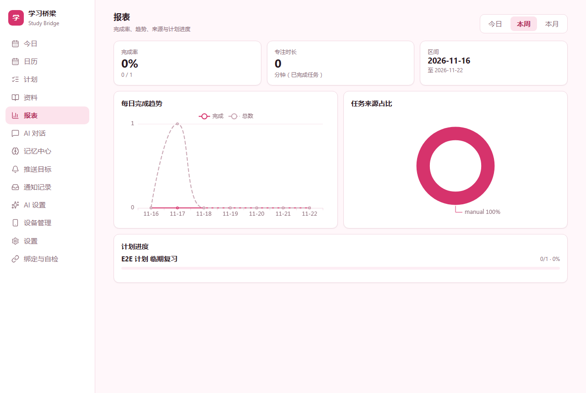
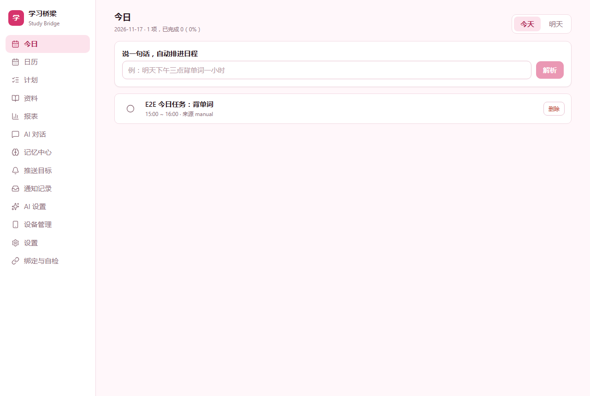
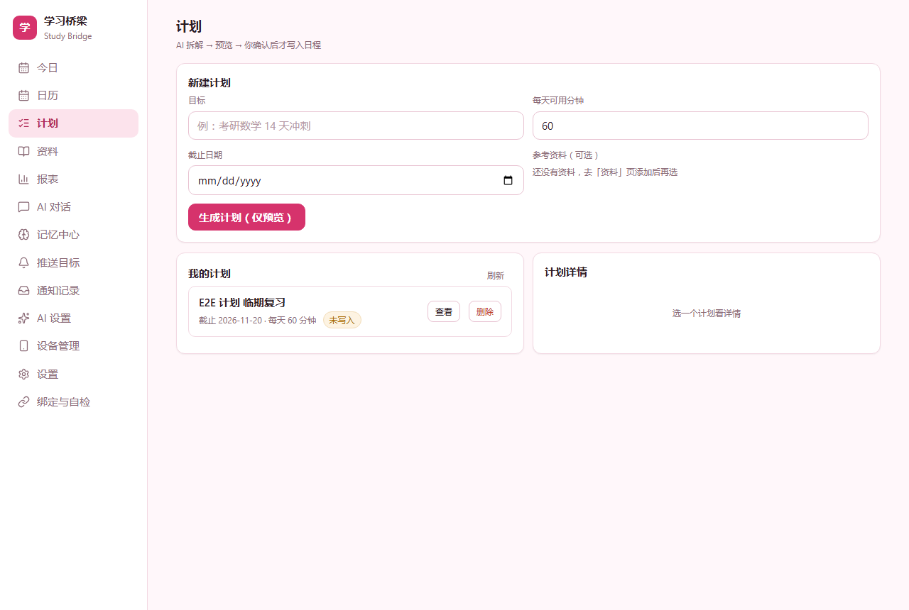
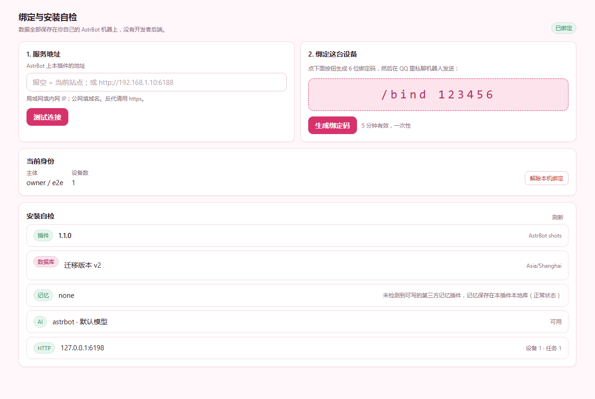
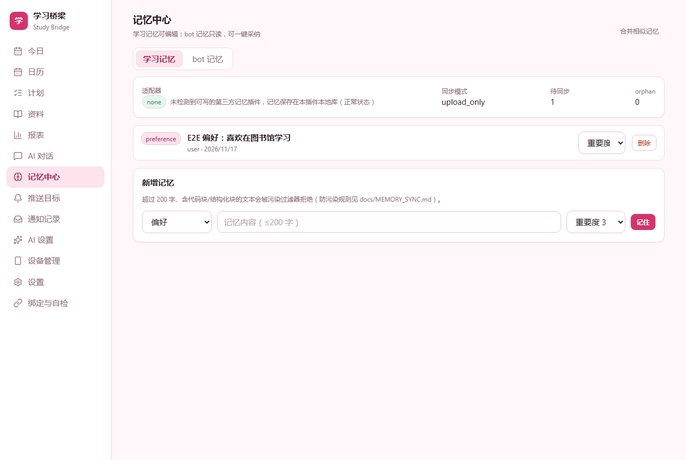
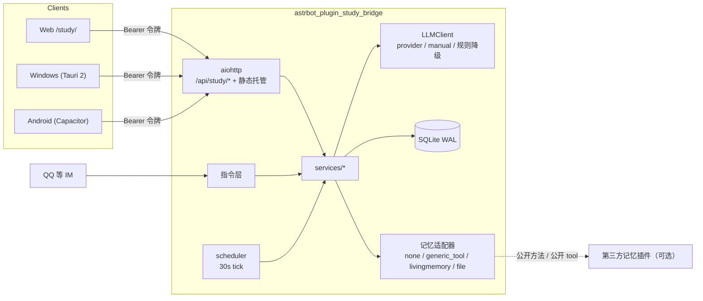

# 学习桥梁 · Study Bridge

> 给 AstrBot 加一套「学习日程 + AI 计划 + 记忆同步」的能力。
> QQ 里能用，网页/安卓也能用；**数据全部留在你自己的机器上**，没有开发者后端。

- 装完**不需要装 App**：`/add` `/today` `/plan` `/report` `/export` 全都能用
- 装 App 也**不需要公网 IP**：局域网 / 反代 / 内网穿透 三种方式都有文档
- **没装任何记忆插件也能用**：检测到就互通，检测不到就降级为本地记忆，插件状态仍是「正常」
- **粉色浅色主题**（`#FFF7FA` 底 + 玫瑰红强调），导航统一用 Lucide 图标，设计约定见 [DESIGN.md](DESIGN.md)
- **安卓客户端已打包**：`dist/StudyBridge.apk`（32.8 KB，免 Gradle 构建，脚本在 `android/`）；
  已在模拟器上实测通过，含 Android 7.0 自带的旧 WebView（Chrome 53）



---

> 🧭 **第一次用？看 [使用指南 docs/USAGE.md](docs/USAGE.md)**：安装 → 必改配置 → 绑手机 → 每天怎么用 → 排障，一篇写完。

## 直接下载

| 产物 | 说明 |
|---|---|
| [dist/astrbot_plugin_study_bridge.zip](dist/astrbot_plugin_study_bridge.zip) | 插件包 v1.1.5（2.0 MB）。AstrBot 面板 → 插件 → 安装 → 选这个 zip，重载即可 |
| [dist/StudyBridge.apk](dist/StudyBridge.apk) | 安卓客户端 v1.1.5（517.8 KB，versionCode 16，minSdk 24）。覆盖安装，填你的插件地址即可 |

两个产物都由源码构建脚本生成（`scripts/package_plugin.py`、`android/build_apk.ps1`），先看 [docs/DEPLOY.md](docs/DEPLOY.md) 了解部署方式。

---

## 功能

| 能力 | QQ | App/Web |
|---|---|---|
| 自然语言加日程（`/add 明天下午三点背单词一小时`） | ✅ | ✅（解析→预览→写入） |
| 今日/明日/本周概览、逾期提醒 | ✅ | ✅（日历 + 今日） |
| AI 拆解学习计划，**确认后**才写入日程 | ✅ `/plan new` → `/apply` | ✅ 弹窗确认 |
| 纯文本报表 / 全量 JSON 导出 | ✅ | ✅ 图表 + 下载 |
| 早报、临期提醒、计划督促、周报 | ✅ 推到指定会话 | ✅ 可在「通知记录」看到成败 |
| 记忆：`/memory` `/forget` | ✅ | ✅ 学习记忆可编辑、bot 记忆可采纳 |
| 多设备绑定与吊销 | ✅ `/bind` `/unbind` | ✅ 设备管理 |
| 中英文切换 | ✅ | ✅ |

| 今日 | 计划 |
|---|---|
|  |  |

| 绑定与自检 | 记忆中心 |
|---|---|
|  |  |

移动端（底部 TabBar）：


---

## 架构



细节见 [`docs/ARCHITECTURE.md`](docs/ARCHITECTURE.md)。

---

## 安装

### 方式 1：面板装 zip（推荐）

1. `python scripts/package_plugin.py` 生成 `dist/astrbot_plugin_study_bridge.zip`；
2. AstrBot 面板 → 插件 → 安装 → 上传 zip；
3. 重载插件，日志出现：

```
学习桥梁已启动：data_dir=... schema=v2 adapter=none
学习桥梁 HTTP 服务已监听 http://0.0.0.0:6188/study/
```

### 方式 2：手动放目录

```bash
git clone <repo> data/plugins/astrbot_plugin_study_bridge
# 或直接复制目录
```

### 方式 3：只想要 QQ

装好后把 `http.enabled` 设为 `false`，重载。所有 QQ 功能照常，不监听任何端口。

> 要求：AstrBot `>=4.24.2,<5`、Python `>=3.12`。低于要求时 `metadata.astrbot_version` 会拒绝加载，
> 不会拖垮其它插件。

### 装到已经在跑的 AstrBot 上

**方式 A：面板上传（最简单）**
AstrBot 面板 → 插件 → 安装 → 选 `dist/astrbot_plugin_study_bridge.zip` → 重载。

**方式 B：一条命令（SSH）**

```powershell
# 只上传 + 解压，不重启
.\scripts\upload_to_astrbot.ps1 -TargetHost 1.2.3.4 -Key C:\path\key.pem

# 上传 + 自动重启 AstrBot
.\scripts\upload_to_astrbot.ps1 -TargetHost 1.2.3.4 -Key C:\path\key.pem -Restart
```

默认解压到 `/opt/astrbot/data/plugins`（用 `-RemotePluginsDir` 可改）。

**方式 C：AstrBot OpenAPI（适合有全权限 api key 的部署）**

```powershell
.\scripts\upload_to_astrbot.ps1 -Mode api -ApiBase https://your-host -ApiKey abk_xxx
```

它调用的是 `POST /api/v1/plugins/install/upload`。注意：**api key 必须带插件安装权限**，
否则会返回 `403 Insufficient API key scope`（这是 AstrBot 的权限模型，不是插件问题）。

---

## 第一步（必做）：QQ 发 `/bind`

1. 浏览器打开 `http://<你的机器IP>:6188/study/`；
2. 首页显示 6 位绑定码；
3. **私聊**机器人发送：`/bind 482913`；
4. App 会自动完成绑定并跳到「今日」。

绑定码 5 分钟有效、一次性、错误 5 次作废。令牌只在兑换时返回一次，库里只存 SHA-256。

---

## 三端

| 端 | 怎么构建 | 产物 |
|---|---|---|
| Web | `make build`（`cd frontend && pnpm build`） | `web/`，由插件在 `/study/` 同源托管 |
| Android | `android\build_apk.ps1 -Jdk <jdk17> -Sdk <android-sdk>` | **`dist/StudyBridge.apk`（已构建，517.8 KB / v1.1.5）** |
| Windows | `cd frontend && pnpm tauri build` | `exe/msi`（需 Rust 工具链） |

三端只填**同一个地址**即可天然同步（同一份后端数据），不做自建同步服务。

### 安卓客户端怎么做的

`android/` 是一个**免 Gradle** 的原生外壳（`aapt2 → javac → d8 → zipalign → apksigner`，
用的就是本机 Android SDK 的 build-tools）：

- 首次打开只有一个输入框：填你的插件地址（`http://192.168.1.10:6188`）；
- 之后用 WebView 打开该地址的 `/study/`，所以**前端升级不用重装 APK**；
- 与网页版同源，令牌存在 WebView 的 localStorage，不存在跨域问题；
- 地址填错/机器关机时，App 会显示一页中文诊断页（地址 / WebView 版本 / JS 报错 / 资源状态）；
- 想换地址：App 里「更多 → 设置 → App 服务器地址 → 换服务器地址」，或长按页面；
- 已声明 `INTERNET` 权限、`usesCleartextTraffic`（局域网 http 可用）、`minSdk 24 / target 34`。

装法：把 `dist/StudyBridge.apk` 传到手机，允许"安装未知来源应用"后安装即可。
想要官方 Capacitor/Tauri 路线也行，配置分别在 `frontend/capacitor.config.ts` 与 `frontend/src-tauri/`。

> 连 `http://` 内网地址：Android 需 `usesCleartextTraffic="true"`（已内置），桌面端默认允许；生产建议上 HTTPS。

---

## 配置项

面板 → 插件 → 学习桥梁 → 配置。所有项都有中文说明与默认值，高风险项带提示。

| 键 | 默认 | 说明 |
|---|---|---|
| `http.enabled` | `true` | 关闭 = 纯 QQ 模式，其余功能不受影响 |
| `http.host` | `0.0.0.0` | 只本机用请填 `127.0.0.1` |
| `http.port` | `6188` | 与面板 6185 错开；被占用会打 ERROR，不静默换端口 |
| `http.public_base_url` | `""` | 反代域名，填了 `/addr` 直接返回它 |
| `http.allowed_origins` | `["*"]` | 生产请填具体来源 |
| `http.rate_limit_per_minute` | `120` | 只作用于 `/api/study/*` |
| `scope.allowed_qq` | `[]` | 空 = 仅机器人主人 |
| `scope.allowed_groups` | `[]` | 空 = 群里仅主人可用 |
| `scope.group_mode` | `per_user` | `per_user` 每人独立 / `per_group` 整群共用 |
| `language` | `zh-CN` | `zh-CN` / `en-US` |
| `default_timezone` | `Asia/Shanghai` | 用户可用 `/settings tz` 覆盖 |
| `notify.early_brief_time` | `08:00` | 早报 |
| `notify.plan_nudge_time` | `21:00` | 计划督促 |
| `notify.weekly_report_*` | 周一 09:00 | 周报 |
| `ai.mode` | `astrbot` | 复用 AstrBot 模型 / 手填接口 |
| `ai.provider_id` | `""` | 留空 = 用当前默认模型 |
| `memory.adapter_order` | `["generic_tool","livingmemory","none"]` | 按序探测，首个可用生效 |
| `memory.sync_mode` | `upload_only` | `off` / `upload_only` / `bidirectional` |
| `memory.budget_tokens` | `1500` | 记忆注入预算 |
| `quota.max_tasks/plans/notifications` | 2000/200/5000 | 单主体上限，超限 409 |

完整 schema 见 [`_conf_schema.json`](_conf_schema.json)。

---

## 记忆插件联动（可选）

- **不装**：`none` 适配器，`/info` 显示 `{"name":"none","ok":true,"degraded":true}`，本地记忆照常；
- **装了通用记忆 tool**：把工具名映射到 `memory.generic_tool`，插件直接调函数（不经模型）；
- **LivingMemory 2.13.0**：已验证，走 `initializer.memory_engine.add_memory / delete_memory`；
  版本不符会自动降级并 WARN，AstrBot 不崩；
- 删除能力缺失 → 标 `orphan` 并在 App 明确显示，**不会假装成功**。

细节与「20 行适配器模板」见 [`docs/MEMORY_SYNC.md`](docs/MEMORY_SYNC.md)。

---

## 隐私

- 所有数据在 `data/plugin_data/astrbot_plugin_study_bridge/`（SQLite + WAL），没有开发者侧服务；
- 令牌只存 SHA-256，明文只在兑换时返回一次；
- 手填 API Key 用 Fernet 加密，接口只回 `has_key`；日志不打印 Key/Token/完整内网地址；
- `memory.sync_mode=bidirectional` 才会读取 bot 侧记忆（配置说明里已写明），默认 `upload_only`；
- 卸载：删掉那个目录即可彻底清除；插件 `terminate()` 会释放端口、取消任务、关闭数据库。

---

## 常见问题

**端口被占用？**
日志会打 `HTTP 服务启动失败：0.0.0.0:6188 无法监听…`。改 `http.port` 后重载；QQ 功能不受影响。

**App 提示 401？**
令牌失效或被吊销。回首页重新生成绑定码，QQ 发 `/bind <码>`。

**App 提示"端口不通"？**
`curl http://<ip>:6188/api/study/health` 先验通；再看防火墙、是否 `http.enabled=false`、手机是否同网段。

**证书不信任？**
App 会明确提示而不是白屏。用 certbot 重签，或在系统里信任该证书（自签场景）。

**早报没收到？**
App「推送目标」里至少加一个（QQ 发 `/umo` 拿到 UMO）；「通知记录」会显示 `failed` 与原因。

**时区不对？**
`/settings tz Asia/Shanghai`，或改 `default_timezone`。

**没有公网 IP？**
用 Cloudflare Tunnel / frp / Tailscale，步骤见 [`docs/DEPLOY.md`](docs/DEPLOY.md) 形态 D。

---

## 验收勾选表（DoD）

| 验收项 | 状态 | 证据 |
|---|---|---|
| 插件可独立安装启动；无记忆插件时全功能可用 | ✅ 结构级 | `pytest tests/test_adapters.py`；真机加载见 KNOWN_ISSUES |
| `http.enabled=false` 下纯 QQ 全功能闭环 | ✅ | `tests/test_commands.py`（不依赖 HTTP）；`docs/QQ_COMMANDS.md` |
| 多主体隔离，越权统一 404 | ✅ | `tests/test_isolation.py` |
| 绑定码流程可用、设备可吊销 | ✅ | `tests/test_auth.py`（一次性/过期/错 5 次作废/吊销即 401） |
| App 首启绑定即可用；三端数据一致 | ✅ Web/API；⏳ 原生包 | `pytest` + Playwright E2E 17 项 |
| HTTP API 全实现且有测试 | ✅ | `docs/API.md` 全量 + `tests/test_http.py` |
| `make test` 全绿；覆盖率 ≥ 70% | ✅ 150 passed / **77%** | 见下方实测输出 |
| AI 可从 provider 选择；计划幂等；不落明文 Key | ✅ | `tests/test_plans.py`、`tests/test_http.py::test_ai_endpoints` |
| QQ 指令全量；早报到点且不重发 | ✅ 逻辑级 | `tests/test_scheduler.py`（dedupe + 重启不重发） |
| 记忆上行默认可用；零侵入；删除状态如实 | ✅ | `tests/test_memory.py`（orphan/回环/相似度/重试） |
| i18n 中英齐备；常量配置化 | ✅ | `tests/test_i18n.py` |
| 9 份文档齐全；README 含 mermaid + 勾选表 | ✅ | `docs/` |
| 无硬编码密钥 | ✅ | `python scripts/lint_secrets.py` 为空 |
| 粉色浅色主题 + 统一图标 | ✅ | `frontend/src/styles.css`、`DESIGN.md`、`docs/images/*.png`（含 `before-*` 对比图） |
| 安卓客户端可安装 | ✅ 已构建；✅ 已在安卓模拟器实测（Android 14 / Chrome 113 与 Android 7.0 / Chrome 53）；⏳ 未在实体手机上手测 | `dist/StudyBridge.apk`（517.8 KB，v1.1.5），`aapt2 dump badging` + `apksigner verify` 通过 |

**实测输出（2026-11-17，1.1.5）**

```
$ .venv/Scripts/python.exe -m pytest -q --cov=core --cov=adapters
150 passed
TOTAL  3939 stmts  892 miss  77%

$ python scripts/e2e.py
19 passed, 1 skipped        # desktop + mobile

$ python scripts/selfcheck.py
10/10 通过                  # 含 info 接口版本 = metadata 1.1.5

$ python scripts/package_plugin.py
文件数：109，大小：2051.2 KB（上限 16384 KB）

$ powershell -File android/build_apk.ps1 -Jdk <jdk17> -Sdk <sdk>
[ok] StudyBridge.apk 530262 bytes

$ aapt2 dump badging dist/StudyBridge.apk
package: name='com.studybridge.app' versionCode='16' versionName='1.1.5'
application-label:'学习桥梁'
sdkVersion:'24'  targetSdkVersion:'34'

$ adb -s emulator-5556 shell cmd webviewupdate set-webview-implementation com.google.android.webview
# Android 7.0 + Chrome/53 上：typeof System=object（走 legacy 包）、#app 已渲染、
# 「测试连接」返回「连接正常 · 插件 1.1.5」、「生成绑定码」得到 6 位码并倒计时
```

未在真机（装了 AstrBot + QQ 的实体手机）验证的项，列在 [`docs/KNOWN_ISSUES.md`](docs/KNOWN_ISSUES.md)，
并给出真机执行步骤，**没有伪造结果**。

---

## 开发与测试

```bash
make venv          # 建虚拟环境
make install       # 装后端 + 前端依赖
make test          # 后端 pytest（150 个用例）
make test-cov      # 带覆盖率
make build         # 前端构建到 web/
make e2e           # Playwright E2E（内置种子数据，不需要 AstrBot）
make selfcheck     # 离线自检（文件/元数据/schema/i18n/运行期/密钥）
make package       # 打 zip
make dev           # 独立调试服务 http://127.0.0.1:6188
```

没有 AstrBot 也能跑：`python -m core.standalone --print-token` 会打印一个可用令牌，
配合 `tests/harness/` 的假 Context / 假 provider / 假记忆引擎即可验证全部业务逻辑。

---

## 文档

[使用指南](docs/USAGE.md) ·
[RESEARCH](docs/RESEARCH.md) ·
[ARCHITECTURE](docs/ARCHITECTURE.md) ·
[API](docs/API.md) ·
[DEPLOY](docs/DEPLOY.md) ·
[QQ_COMMANDS](docs/QQ_COMMANDS.md) ·
[MEMORY_SYNC](docs/MEMORY_SYNC.md) ·
[MARKETPLACE](docs/MARKETPLACE.md) ·
[KNOWN_ISSUES](docs/KNOWN_ISSUES.md) ·
[验收清单](docs/README.md) ·
[设计约定](DESIGN.md)

## License

MIT，见 [LICENSE](LICENSE)。
