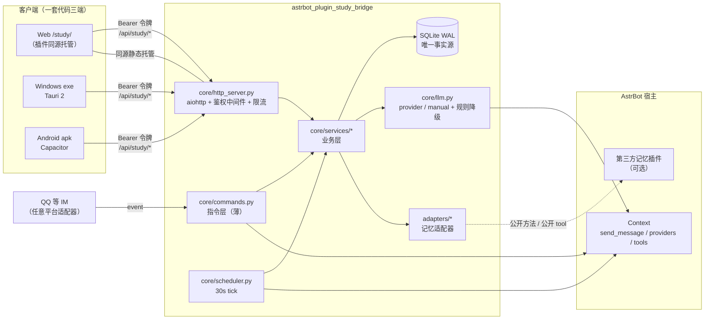
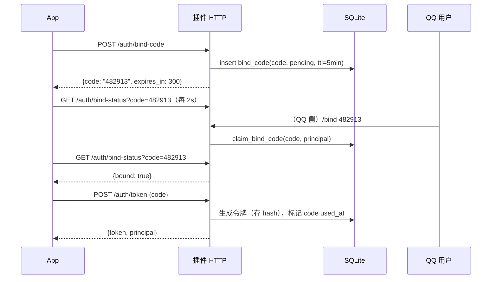
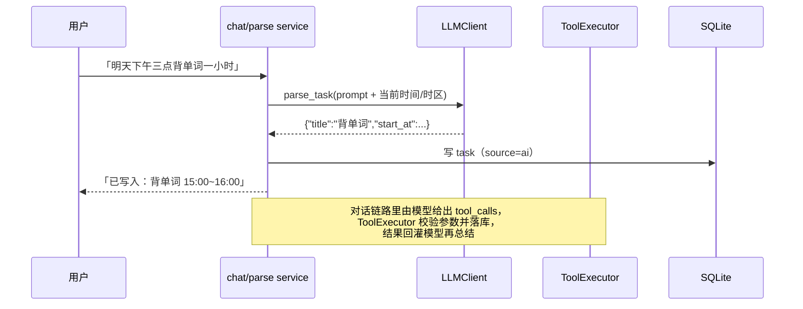

# ARCHITECTURE — 架构与数据流

## 1. 一张图



## 2. 分层与依赖方向

```
main.py                 只做编排：配置 → StudyApp → HTTP/调度/指令注册
  └─ core/app.py        StudyApp 容器（db / cfg / llm / adapters / services / scheduler）
       ├─ core/services/*     业务规则（只依赖 app.db / app.cfg / app.llm 等）
       ├─ core/http_server.py 传输层（aiohttp，把 ApiError 映射成 JSON 信封）
       ├─ core/scheduler.py   定时（30s tick，按 principal 读配置）
       ├─ core/commands.py    指令层（参数解析 + 文案，业务全调 service）
       ├─ core/llm.py         LLM 客户端（provider / manual）+ 规则解析降级
       └─ core/db.py          SQLite（WAL、单写锁、迁移）
adapters/*               记忆适配器（零侵入访问第三方插件）
core/bridge.py           AstrBot 兼容层（真机用官方 API，测试用替身）
```

规则：

- **`core/` 与 `adapters/` 不 import astrbot**（只有 `core/bridge.py`、`main.py` 例外）；
- 依赖方向单向：`main → core → adapters`，adapters 只依赖传入的 `app`；
- 所有业务入口都接受 `Principal`，SQL 一律带 `owner_principal_id`。

## 3. 关键决策

### 3.1 为什么自建 HTTP 服务，而不是挂到 AstrBot Dashboard

调研结论（见 `RESEARCH.md §1.6`）：插件的 `context.register_web_api()` 只能挂在 Dashboard 上，
并且强制 Dashboard 鉴权（`require_plugin_scope` / `require_dashboard_user`）。App 只持有绑定码
换来的 Bearer 令牌，无法访问；把数据面挂到用户管理面下也会扩大攻击面。

因此：自建 `aiohttp`（默认 `0.0.0.0:6188`），同源托管 `/study/` 静态页与 `/api/study/*`；
`http.enabled=false` 时完全不启动服务，其余功能 100% 可用。

### 3.2 为什么对话用"JSON 工具协议"而不是 provider 原生 function calling

AstrBot 里不同 provider 对原生工具调用的支持程度不一致（OpenAI / Anthropic / Gemini / 本地
Ollama 各有差异），而且原生 FC 无法在离线单测里稳定复现。这里采用统一 JSON 协议：

```
模型输出：{"reply": "...", "tool_calls": [{"name": "create_task", "args": {...}}]}
```

- 工具定义只有一份（`core/ai/tools.py`），同时用于生成 system prompt 和参数校验；
- 参数不合法 → 把错误回灌模型重试（最多 1 次），仍失败则友好提示；
- 单次请求最多 6 轮工具调用，超出中断；
- 每次写库都落 `ai_action_log`；
- `apply_plan` 永不自动执行：工具直接返回 `needs_confirmation`，必须用户 `/apply` 或 App 点确认。

### 3.3 时间与时区

- 存储：UTC ISO8601（带 `+00:00`，保留微秒用于判断"是否被改过"）；
- 计算：一律按主体时区 `setting.tz`（默认取插件配置 `default_timezone`）换算"今天/明天/本周"；
- `/today` 的边界是本地 `[00:00, 次日 00:00)`，`23:59` 属于今天，次日 `00:00` 不属于（有单测）。

### 3.4 数据隔离

- 每个请求先解析 `Principal`（owner / user / group），业务 SQL 必须带 `owner_principal_id`；
- 越权访问他人资源 → 统一 **404**（不是 403，避免泄露存在性）；
- 群聊模式：`per_user`（每人独立）或 `per_group`（整群共用），由 `scope.group_mode` 决定；
- 令牌只存 SHA-256，明文只在兑换时返回一次；设备吊销后下一次请求立即 401。

## 4. 数据流

### 4.1 绑定（一次）



### 4.2 指令（QQ 侧）

`event → commands.dispatch → 白名单检查 → 解析参数 → service → 文案渲染 → yield event.plain_result`

所有指令只读事件对象：`event.unified_msg_origin`、`event.get_sender_id()`、`event.get_group_id()`、
`event.is_private_chat()`、`event.is_admin()`。代码里不存在手工拼接 UMO 的地方。

### 4.3 AI 排日程



LLM 不可用 → 规则解析（正则）兜底，并把 `source` 如实标为 `rule`。

### 4.4 调度

单 asyncio 循环，30s tick：

1. 发送所有到期通知（`status='pending' AND scheduled_at <= now`）；
2. 处理记忆上行队列（指数退避，最多 10 次）；
3. 对每个「有启用推送目标」的主体：早报（默认 08:00）、计划督促（21:00）、周报（周一 09:00）、
   23:30 consolidation、周日 03:10 记忆对账。

幂等靠两类键：

- `notification.dedupe_key`（唯一索引）：`task:{id}:{offset}`、`daily_brief:{principal}:{date}`；
- `setting` 里的 `__job:{job}` 标记（记录"今天已经跑过"）。

两者都在 DB 里，所以**重启不会重发**（有单测覆盖）。

## 5. 目录职责

| 路径 | 职责 |
|---|---|
| `main.py` | Star 子类；注册指令（必须在 main 模块，AstrBot 按模块路径精确匹配 handler）；启停 |
| `core/app.py` | 容器与依赖装配；`principal_for_event()`；`info()` |
| `core/db.py` | 连接、WAL、单写锁、迁移（失败拒绝启动） |
| `core/principal.py` | Principal / 令牌 / 绑定码 / 限流器 |
| `core/http_server.py` | 路由、鉴权中间件、限流、CORS、静态托管 |
| `core/services/` | task / plan / stats / chat / memory / notify / auth / material / settings / export |
| `core/scheduler.py` | 定时任务与幂等 |
| `core/llm.py` + `core/ai/` | provider 选择、手填接口、规则解析、prompt、工具定义 |
| `adapters/` | null / generic_tool / livingmemory / file 适配器 |
| `i18n/` | 中英文案（缺 key 回退中文） |
| `web/` | 前端构建产物（随插件分发） |
| `frontend/` | Vue3 + TS + Vite 源码，含 Tauri / Capacitor 配置 |

## 6. 失败与降级矩阵

| 失败点 | 行为 |
|---|---|
| 端口被占 | 打 ERROR，提示改 `http.port`；QQ 功能照常，插件不崩 |
| AI 不可用/超时 | 规则解析兜底，`source=rule`，接口 200 |
| 模型返回非 JSON | 重试 1 次，仍失败走规则解析 |
| 无记忆插件 | `none` 适配器可用（`ok:true, degraded:true`），本地记忆照常 |
| 记忆插件版本不符 | `probe()` False + WARN，降级下一个适配器，`/info` 如实显示原因 |
| 远端不支持删除 | 标 `orphan` 并在 App 明示，**不报成功** |
| 平台不在线 | 发送返回 False，通知记 `failed` + error，不影响其它主体 |
| 迁移失败 | 回滚 + 抛 `MigrationError`，插件拒绝启动并说明原因 |
| AstrBot 版本过低 | `metadata.astrbot_version` 拦截加载；运行期再检测一次并 WARN |
